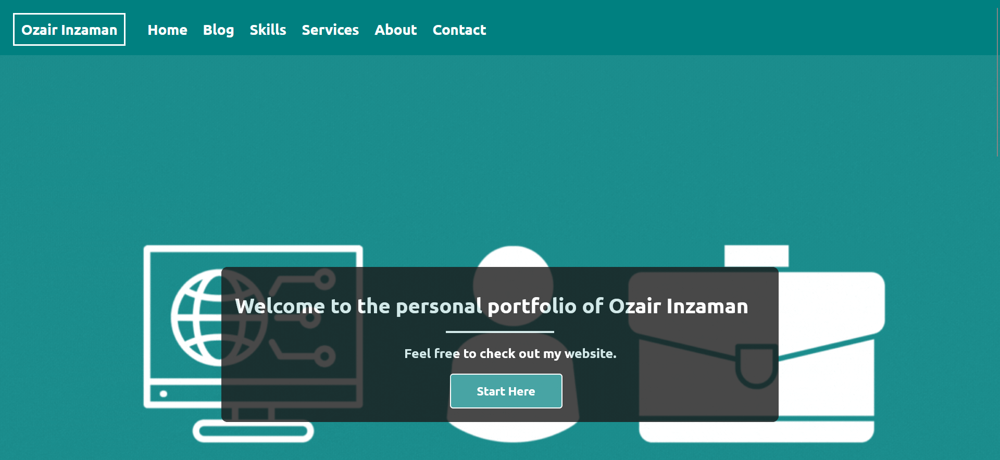
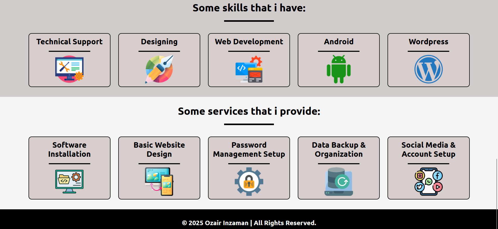
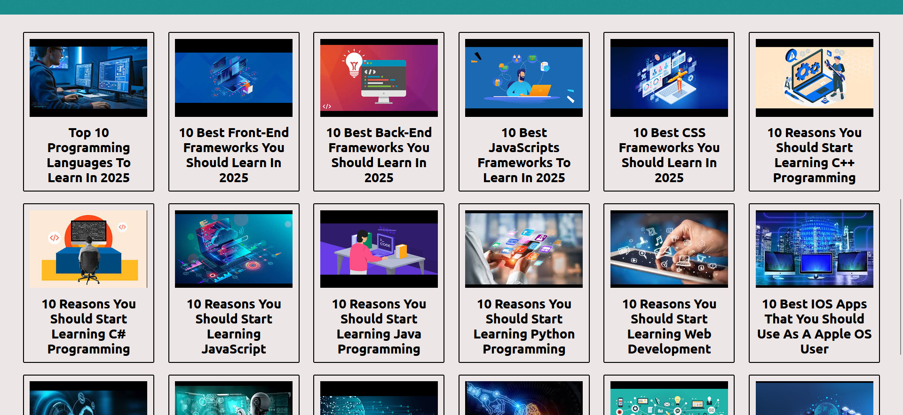
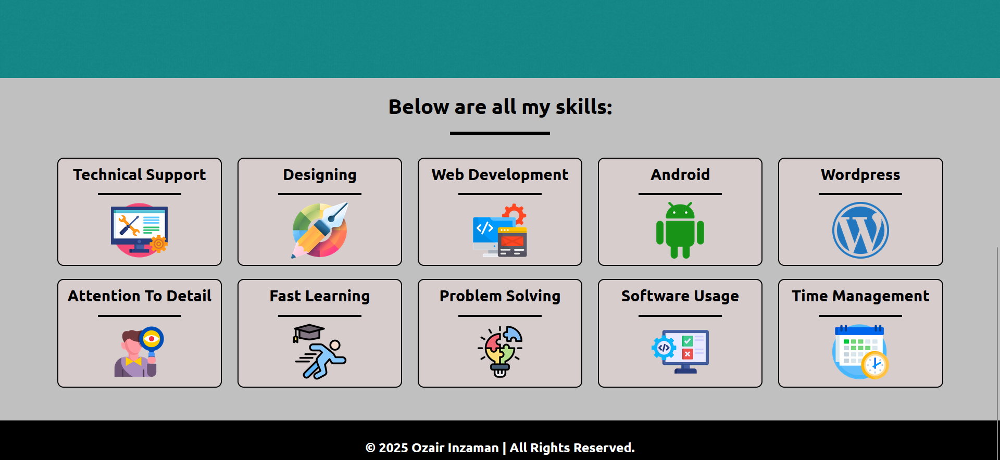
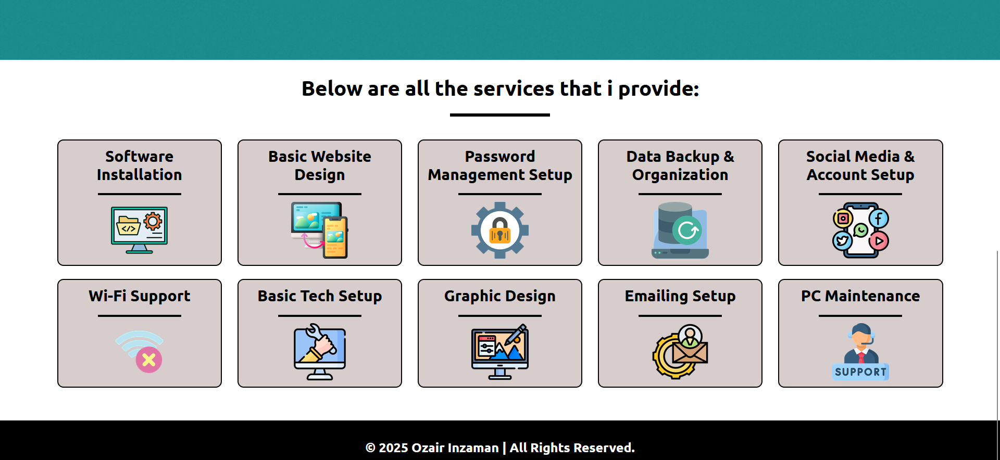
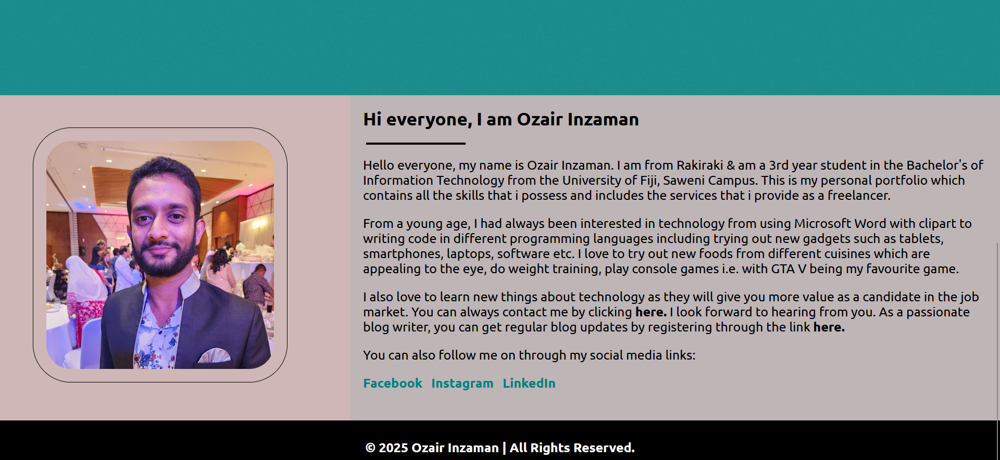
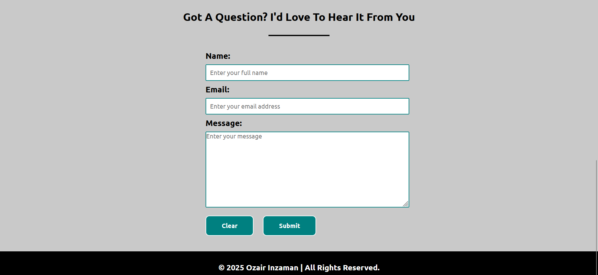

# Personal Portfolio Website

A multi-page, responsive personal portfolio built with **HTML, CSS, JavaScript and Firebase**, following a waterfall workflow: planning → design → development → testing. The site presents my skills, freelance services and tech blog, and includes a contact form and blog sign-up that store submissions in Firestore, plus a login-gated dashboard.

> ⚠️ This is an academic project that runs locally and is **not hosted online**. The login page is a front-end demonstration only (credentials are checked in client-side JavaScript), so it is not secure authentication. See [Running Locally](#running-locally) to view the site.

## Project Environment

| | |
|---|---|
| Project type | Academic project |
| Duration | Feb – May 2025 |
| Editor | Visual Studio Code (Live Server extension) |
| Backend | Firebase (Firestore) |
| Testing | Browser developer tools and responsive design mode |

## Tools & Technologies


## Contents

### 1. [Home](./index.html)
Landing page with an animated GIF banner and call-to-action, followed by previews of recent blog posts, key skills and the services I offer.

<p align="center">
  
  
</p>

### 2. [Blog](./blog.html) and [Blog Post Template](./post-template.html)
A grid of 18 tech blog topics (programming languages, frameworks, apps and project ideas for IT students), each linking to a reusable post template with introduction, details and conclusion sections.

<p align="center">
  
</p>

### 3. [Skills](./skills.html) and [Services](./services.html)
Icon-card layouts presenting my technical and soft skills alongside the freelance services I provide, such as software installation, website design, Wi-Fi support, data backup and PC maintenance.

<p align="center">
  
  
</p>

### 4. [About](./about.html) and [Contact](./contact.html)
A personal introduction with background, interests and social links, plus a validated contact form (name, email, message) that submits to **Firebase Firestore** and redirects to a [confirmation page](./contact-success.html).

<p align="center">
  
  
</p>

### 5. [Blog Sign Up](./signup.html), [Login](./login.html) and [User Dashboard](./user-dashboard.html)
A sign-up form for blog updates (stored in Firestore, with a [confirmation page](./signup-success.html)), and a login page that uses JavaScript credential verification to control access to a simple dashboard with quick links and a log-out action.

## Methodology

The project followed a waterfall approach: requirements and planning, design (mockup and architecture sketched on paper), implementation from a task checklist, then testing. Core pages (Home, About, Contact, Services, Blog) reuse shared HTML and CSS to reduce development time, with `div`-based banners and sections for layout.

Responsiveness is handled through separate `desktop.css`, `tablet.css` and `mobile.css` stylesheets using CSS media queries. On-page SEO includes meta tags, descriptive headings, image alt text and meaningful page names. Banners are GIFs made in Canva and icons come from Flaticon. Testing used the browser's built-in inspection and responsive design tools, and bugs were fixed during development.

## Project Structure

```
├── index.html
├── about.html
├── skills.html
├── services.html
├── blog.html
├── post-template.html
├── contact.html
├── contact-success.html
├── signup.html
├── signup-success.html
├── login.html
├── user-dashboard.html
├── styles/         # styles.css, desktop.css, tablet.css, mobile.css
├── scripts/        # scripts.js, firebase-init.js
├── images/         # page banners and profile photos
├── icons/          # skill and service icons
├── posts-images/   # blog post thumbnails
└── screenshots/    # README preview images
```
## Security Note

Firebase web configuration values are public by design, and data access is controlled by Firestore security rules. Sensitive files such as debug tokens are excluded from this repository through `.gitignore`. The demo login is not a security feature, and no private data is stored on the dashboard.

## Author

**Ozair Inzaman**

- [Facebook](https://www.facebook.com/ozzyinzaman/)
- [Instagram](https://www.instagram.com/inzamanozzy/)
- [LinkedIn](https://fj.linkedin.com/in/ozair-inzaman-50796b207)

&copy; 2025 Ozair Inzaman. All rights reserved.
